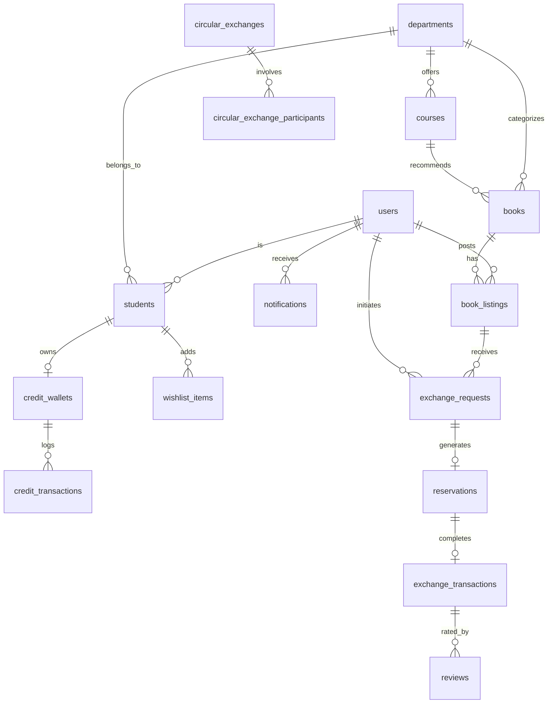

# 📚 BookLoop – Smart Student Book Exchange & E-Commerce Management System

> **Tagline:** *"Your old books. Someone else's next semester."*  
> **Course:** Advanced Java Programming (Target Level: **OUTSTANDING** – Event Handling + Java Swing + JDBC + MySQL Transactions + DFS Graph Theory)  
> **Architecture:** Pure Desktop Application (Java Swing + FlatLaf + MySQL 8.0 + Apache Maven)

---

## 📑 Table of Contents
1. [Project Overview & Core Mission](#1-project-overview--core-mission)
2. [Mandatory 5-Member Team Architecture & Code Ownership](#2-mandatory-5-member-team-architecture--code-ownership)
3. [System Architecture & Design Patterns](#3-system-architecture--design-patterns)
4. [Complete Feature-by-Feature Detailed Walkthrough](#4-complete-feature-by-feature-detailed-walkthrough)
   - [Feature 1: User Authentication & Role-Based Access Control](#feature-1-user-authentication--role-based-access-control)
   - [Feature 2: Marketplace, Catalog & Multi-Parameter Search](#feature-2-marketplace-catalog--multi-parameter-search)
   - [Feature 3: Listing Books with Cover Image Uploads](#feature-3-listing-books-with-cover-image-uploads)
   - [Feature 4: Direct 1-to-1 Exchange & Campus Meetup Workflow](#feature-4-direct-1-to-1-exchange--campus-meetup-workflow)
   - [Feature 5: Graph DFS Circular Exchange Matching Engine](#feature-5-graph-dfs-circular-exchange-matching-engine)
   - [Feature 6: Virtual Credit Wallet & ACID Double-Entry Ledger](#feature-6-virtual-credit-wallet--acid-double-entry-ledger)
   - [Feature 7: Administrator Command Center & 2D Graphical Analytics](#feature-7-administrator-command-center--2d-graphical-analytics)
   - [Feature 8: Real-Time In-App Notification Engine](#feature-8-real-time-in-app-notification-engine)
5. [Visual Design System & Color Palette](#5-visual-design-system--color-palette)
6. [Complete Database Schema (13 Tables)](#6-complete-database-schema-13-tables)
7. [Installation, Database Setup & Execution Guide](#7-installation-database-setup--execution-guide)
8. [Demonstration Credentials (Pre-Seeded)](#8-demonstration-credentials-pre-seeded)
9. [Academic Viva Voce Defense & Examiner Q&A Guide](#9-academic-viva-voce-defense--examiner-qa-guide)

---

## 1. Project Overview & Core Mission

Textbooks are one of the heaviest recurring financial burdens for college students, with students frequently purchasing expensive textbooks for a single semester, only for them to sit unused on shelves afterward. Traditional e-commerce platforms (Amazon, eBay) suffer from high shipping fees, long transit times, and lack of campus trust.

**BookLoop** is a specialized desktop marketplace and intelligent exchange platform designed specifically for college campuses. Built entirely in **Java Swing** and powered by **MySQL via JDBC**, BookLoop enables students to:
- **Buy & Sell:** Direct peer-to-peer textbook sales at fair student rates.
- **Direct Exchange (1-to-1):** Swap books with classmates for mutually required courses.
- **Circular Exchange ($A \to B \to C \to A$):** Multi-party trade loops detected by graph algorithms when direct reciprocal trades do not exist.
- **Rent:** Short-term textbook rentals for specific exam periods or assignments.
- **Donate:** Pass books down to juniors for free, fostering academic community support.
- **Virtual Credit Economy:** Cashless transactions backed by a secure credit wallet rewarded upon verified textbook handover.

---

## 2. Mandatory 5-Member Team Architecture & Code Ownership

To ensure fair academic evaluation, the codebase is partitioned into **five distinct modules** with balanced responsibilities across Java OOP, Swing GUI design, JDBC database transactions, concurrency, algorithms, and documentation:

```
┌────────────────────────────────────────────────────────────────────────┐
│                        BOOKLOOP APPLICATION SHELL                      │
│                  Main.java • MainDashboardFrame • Sidebar              │
└───────────────────────────────────┬────────────────────────────────────┘
                                    │
    ┌──────────────┬────────────────┼───────────────┬────────────────┐
    │              │                │               │                │
┌───▼──────────┐ ┌─▼────────────┐ ┌─▼───────────┐ ┌─▼────────────┐ ┌─▼───────────┐
│   MEMBER 1   │ │   MEMBER 2   │ │  MEMBER 3   │ │   MEMBER 4   │ │  MEMBER 5    │
│ Authentication│ │ Marketplace &│ │ Exchange &  │ │ Graph Matching│ │ Admin Panel &│
│  & Security  │ │ Book Catalog │ │ Reservations│ │ & Credit Wall│ │ Analytics   │
└──────────────┘ └──────────────┘ └─────────────┘ └──────────────┘ └─────────────┘
```

| Member | Module Name | Primary Responsibilities | Core Classes Owned | Database Tables Owned |
|---|---|---|---|---|
| **Member 1** | **Authentication, Security & Profiles** | User registration, BCrypt password salting, regex input validation, session management, multi-table atomic registration transactions. | `User`, `Student`, `Admin`, `UserDAO`, `AuthenticationService`, `LoginController`, `LoginFrame`, `RegisterFrame`, `ProfilePanel` | `users`, `students` |
| **Member 2** | **Marketplace, Catalog & Search** | Dynamic multi-filtered catalog, image caching, condition disclosure tags, personalized recommendations, asynchronous `SwingWorker` queries. | `Book`, `BookListing`, `WishlistItem`, `BookDAO`, `ListingDAO`, `WishlistDAO`, `BookService`, `ListingService`, `MarketplacePanel`, `AddListingPanel`, `BookCard`, `BookDetailsPanel` | `books`, `book_listings`, `departments`, `courses`, `wishlist_items` |
| **Member 3** | **Exchange Workflow & Reservations** | 1-to-1 trade proposals, 7-day pickup expiry timer, two-party handshake verification, reservation state machines, peer trust reviews. | `ExchangeRequest`, `Reservation`, `Review`, `ExchangeTransaction`, `ExchangeDAO`, `ReservationDAO`, `ReviewDAO`, `ExchangeService`, `ReservationService`, `ExchangeRequestsPanel`, `ReservationPanel`, `HistoryPanel` | `exchange_requests`, `reservations`, `exchange_transactions`, `reviews` |
| **Member 4** | **Graph DFS Matching & Virtual Credits** | Directed exchange graph modeling, bounded DFS cycle detection ($A \to B \to C \to A$), canonical rotational hashing, ACID balance transfers with ledger audit logs. | `ExchangeGraph`, `CycleDetection`, `MatchingEngine`, `CreditWallet`, `CreditTransaction`, `CreditDAO`, `CreditService`, `MatchingService`, `WalletController`, `CircularExchangePanel`, `WalletPanel` | `credit_wallets`, `credit_transactions`, `circular_exchanges`, `circular_exchange_participants` |
| **Member 5** | **Administration, Analytics & Alerts** | Complex analytical SQL subqueries, custom anti-aliased 2D charts, student moderation, dispute management, automated notifications. | `Notification`, `NotificationDAO`, `AnalyticsDAO`, `NotificationService`, `AnalyticsService`, `AdminController`, `AdminDashboardPanel`, `UserManagementPanel`, `ListingManagementPanel`, `AnalyticsPanel`, `StatCard`, `NotificationPanel` | `notifications` |

---

## 3. System Architecture & Design Patterns

BookLoop adheres to a strict **Layered Enterprise Architecture (MVC)**:

```
com.bookloop
├── Main.java                          # App entry point, FlatLaf theme, DB fallback
├── config/                            # Database connection pooling & app settings
│   ├── AppConfig.java
│   ├── DatabaseConfig.java
│   └── DatabaseConnection.java       # Custom thread-safe Connection Pool (BlockingQueue)
├── model/                             # Domain Entities (Plain Old Java Objects)
│   ├── User.java, Student.java, Admin.java
│   ├── Book.java, BookListing.java, WishlistItem.java
│   ├── ExchangeRequest.java, Reservation.java, ExchangeTransaction.java
│   ├── ExchangeCycle.java, MatchResult.java
│   ├── CreditWallet.java, CreditTransaction.java
│   └── Review.java, Course.java, Department.java, Notification.java
├── dao/                               # Data Access Layer (Direct JDBC & PreparedStatements)
│   ├── UserDAO.java, BookDAO.java, ListingDAO.java, WishlistDAO.java
│   ├── ExchangeDAO.java, ReservationDAO.java, ReviewDAO.java
│   ├── CreditDAO.java, NotificationDAO.java, AnalyticsDAO.java
├── service/                           # Business Logic, ACID Transactions & Rules
│   ├── AuthenticationService.java, BookService.java, ListingService.java
│   ├── ExchangeService.java, ReservationService.java, ReviewService.java
│   ├── CreditService.java, MatchingService.java, NotificationService.java
│   └── AnalyticsService.java
├── controller/                        # Coordinates UI events with Service methods
│   ├── LoginController.java, BookController.java, ExchangeController.java
│   ├── WalletController.java, AdminController.java
├── algorithm/                         # Graph Theory & Combinatorial Matching
│   ├── ExchangeGraph.java             # Directed graph adjacency structure
│   ├── CycleDetection.java            # Bounded DFS cycle detection with canonical hashing
│   └── MatchingEngine.java            # Real-data graph builder & cycle generator
├── ui/                                # Swing User Interface
│   ├── LoginFrame.java, RegisterFrame.java, MainDashboardFrame.java
│   ├── components/                    # Reusable UI Design System
│   │   ├── BookCard.java, Sidebar.java, StatCard.java, NotificationPanel.java, ReviewDialog.java
│   ├── student/                       # Student Screens
│   │   ├── StudentDashboardPanel.java, MarketplacePanel.java, AddListingPanel.java
│   │   ├── MyListingsPanel.java, BookDetailsPanel.java, WishlistPanel.java
│   │   ├── ExchangeRequestsPanel.java, ReservationPanel.java, CircularExchangePanel.java
│   │   ├── WalletPanel.java, RecommendationsPanel.java, HistoryPanel.java, ProfilePanel.java
│   └── admin/                         # Administrator Screens
│       ├── AdminDashboardPanel.java, UserManagementPanel.java
│       ├── ListingManagementPanel.java, AnalyticsPanel.java
└── util/                              # Utilities
    ├── ValidationUtil.java            # Email, password, ISBN-10/13 checksum validation
    ├── PasswordUtil.java              # jBCrypt salt + hash generation & verification
    ├── DateUtil.java                  # Relative timestamp & date formatting
    ├── ImageUtil.java                 # Image scaling, cover caching, UUID upload storage
    ├── UIUtil.java                    # FlatLaf theme, custom palette, buttons, cards, badges
    ├── SessionManager.java            # Thread-safe user session singleton
    └── GenerateBookCovers.java        # Procedural 2D book cover art generator
```

---

## 4. Complete Feature-by-Feature Detailed Walkthrough

### Feature 1: User Authentication & Role-Based Access Control
* **Atomic Registration Transaction:** When a student registers, `UserDAO.registerStudent()` executes a single atomic transaction spanning three tables:
  ```sql
  START TRANSACTION;
  INSERT INTO users (name, email, password_hash, role, phone) VALUES (?, ?, ?, 'STUDENT', ?);
  INSERT INTO students (user_id, student_id_number, department_id, year_of_study) VALUES (?, ?, ?, ?);
  INSERT INTO credit_wallets (student_id, credit_balance) VALUES (?, 100.00); -- Welcome bonus credits
  COMMIT;
  ```
  If any insert fails, the entire transaction rolls back via `conn.rollback()`.
* **Security & Salting:** Passwords are never stored in plaintext. `PasswordUtil` uses **jBCrypt** with an automatically generated work factor 12 salt.
* **Input Validation:** `ValidationUtil` enforces academic email domains, strong passwords (uppercase, lowercase, number, special character), and valid phone numbers.
* **Role-Based Routing:** Upon successful authentication, `LoginController` checks `user.getRole()`. Administrators are routed to the Admin Command Center, while students are routed to the Student Marketplace.

---

### Feature 2: Marketplace, Catalog & Multi-Parameter Search
* **Dynamic Search Query:** Students can filter thousands of textbooks in real time using:
  - Free-text search matching title, author, or ISBN.
  - Department filter dropdown.
  - Listing type tab (All, Buy, Exchange, Rent, Donate).
  - Condition chips (New, Excellent, Good, Acceptable).
* **Asynchronous `SwingWorker` Pipeline:** As the user types in the search bar, a debounced `SwingWorker` queries MySQL in the background and populates the card grid without blocking UI scrolling or window resizing.
* **Personalized Recommendations:** `RecommendationsPanel` cross-references the student's department and current year of study against required course curricula, displaying textbooks relevant to their upcoming semester.

---

### Feature 3: Listing Books with Cover Image Uploads
* **Full Book Metadata Entry:** Title, author, ISBN-10 or ISBN-13 (validated via checksum algorithm), edition, subject, and department.
* **Dedicated Cover Photo Upload System:**
  - Students click **"Upload Book Cover 📸"** in `AddListingPanel`.
  - A `JFileChooser` filtered exclusively for image formats (`.jpg`, `.png`, `.jpeg`, `.webp`) opens.
  - Upon selection, a live scaled preview appears in `imagePreviewLabel`, displaying the file name and size in KB.
  - Students can click **"Remove Photo ❌"** to clear or choose another photo.
  - When published, `ImageUtil.saveImage()` generates a collision-free UUID file name, safely copies the image into the local `book_images/` directory, and records the path in both `books.cover_image` and `book_listings.image_path`.
* **Procedural Cover Art Fallback:** If a listing does not have an uploaded photo, BookLoop's `ImageUtil` automatically loads the procedural 2D artwork generated for standard academic titles (`book_images/book_1.png` to `book_15.png`).
* **Condition Transparency Disclosure:** Highlighting, annotations/notes, missing pages, damaged covers, torn pages, or water damage can be disclosed via checkboxes, rendering transparency badges on the details page.

---

### Feature 4: Direct 1-to-1 Exchange & Campus Meetup Workflow
* **Proposal Flow:** A student browsing a book clicks **"Request Book 🤝"**, types a message proposing a campus meetup spot (e.g., *"Central Library at 2 PM"*), and sends the request.
* **State Machine:**
  ```
  [REQUESTED] ──(Owner Accepts)──> [RESERVED] ──(Physical Handover)──> [COMPLETED]
        │                               │
  (Owner Rejects)               (7-Day Timer Expires)
        │                               │
        ▼                               ▼
   [REJECTED]                       [EXPIRED]
  ```
* **7-Day Pickup Reservation Window:** When an owner accepts, the book moves from `AVAILABLE` to `RESERVED` and a 7-day expiration countdown starts (`reservations.expires_at`). If students fail to meet within 7 days, the reservation expires automatically and the book returns to `AVAILABLE`.
* **Handshake Verification:** Once the students meet on campus, the owner marks the book as handed over. The system records an `exchange_transactions` entry, transfers ownership, and prompts both parties to leave a 1-to-5 star trust review with comments.

---

### Feature 5: Graph DFS Circular Exchange Matching Engine
Direct reciprocal exchanges ($A$ has what $B$ wants, and $B$ has what $A$ wants) only occur in ~5% of student interactions. The **Circular Exchange Matching Engine** solves this by finding multi-party trading loops:

```
    Student A (Alice)  ──── has OS, wants DSA ────>  Student B (Bob)
            ▲                                               │
            │                                               │
      has DBMS, wants OS                              has DSA, wants DBMS
            │                                               │
            └──────────  Student C (Carol)  <───────────────┘
```

#### Algorithmic Implementation Details
1. **Graph Construction:** `ExchangeGraph` builds a directed graph $G = (V, E)$, where vertices $V$ are students, and a directed edge $u \to v$ exists if student $u$ owns a book that matches an item on student $v$'s wishlist.
2. **Bounded Depth-First Search (DFS):** `CycleDetection.findCycles()` traverses the graph from each node up to a maximum depth bound of 5 (since loops larger than 5 students become impractical for campus meetups).
3. **Rotational Cycle Deduplication (Canonical Hashing):** A cycle $A \to B \to C \to A$ is topologically identical to $B \to C \to A \to B$ and $C \to A \to B \to C$. To prevent duplicate notifications, the engine sorts the student IDs in the path and hashes them into a single canonical identifier (`canonicalCycleHash`).
4. **Execution:** Once detected, the loop is presented in `CircularExchangePanel`. When all participants confirm, the system executes atomic multi-row updates moving all books simultaneously.

---

### Feature 6: Virtual Credit Wallet & ACID Double-Entry Ledger
* **Campus Cashless Currency:** Students earn virtual credits by donating or exchanging textbooks, which they can redeem to obtain books from other students without exchanging physical money.
* **ACID Transaction Guarantee in `CreditDAO.java`:**
  ```java
  conn.setAutoCommit(false);
  // 1. Lock sender wallet using pessimistic row-locking
  PreparedStatement lockStmt = conn.prepareStatement(
      "SELECT credit_balance FROM credit_wallets WHERE student_id = ? FOR UPDATE");
  // 2. Validate balance >= transfer amount
  // 3. Deduct from sender, add to recipient
  // 4. Insert dual audit entries in credit_transactions
  conn.commit();
  ```
* **Daily Campus Bonus Restriction (1 Claim Per Day):** Students can claim a +25 credit bonus once per calendar day. `CreditDAO.hasClaimedDailyBonusToday()` verifies against `DATE(ct.created_at) = CURRENT_DATE()`. If already claimed, the button automatically updates to `"Daily Bonus Claimed Today ✅"` and is disabled, with server-side validation preventing multiple claims.
* **Audit Logging:** Every credit movement records the transaction type (`EXCHANGE_REWARD`, `BOOK_PURCHASE`, `RENTAL_FEE`, `ADMIN_ADJUSTMENT`), transaction reference, amount, and timestamp.

---

### Feature 7: Administrator Command Center & 2D Graphical Analytics
* **Executive KPI Cards:** Real-time metrics computed via aggregate SQL queries (`COUNT(DISTINCT student_id)`, `SUM(amount)`, `COUNT(status = 'AVAILABLE')`).
* **Custom Anti-Aliased 2D Charts (`AnalyticsPanel`):**
  - Rendered using native Java `Graphics2D` with `RenderingHints.KEY_ANTIALIASING`.
  - **Category Breakdown Chart:** Visualizes distribution of books across departments (CSE, ECE, ME, CE, MBA).
  - **Trade Activity Chart:** Monthly bar graph tracking transaction volume and completion rates.
* **User Roster Moderation:** Administrators can inspect any student account, review their exchange history, and suspend or reactivate accounts in case of campus disputes.
* **Listing Moderation:** Ability to remove misclassified, duplicate, or inappropriate book listings.

---

### Feature 8: Real-Time In-App Notification Engine
* **Event-Driven Alerts:** Automated notifications triggered whenever:
  - An exchange request is received, accepted, or rejected.
  - A 7-day pickup reservation is nearing expiration.
  - A circular trade loop involving the student is discovered.
  - Credit wallet balance updates occur.
* **Notification Flyout (`NotificationPanel`):** Unread count badge in the sidebar header with one-click "Mark All as Read" functionality.

---

## 5. Visual Design System & Color Palette

BookLoop features a customized **FlatLaf Light** theme using the warm peach, soft coral, and deep plum palette requested for a modern, Gen-Z-friendly aesthetic:

| Color Name | Hex Code | Visual Swatch | Semantic Application in BookLoop |
|---|---|---|---|
| **Warm Peach** | `#F4A261` |  | Primary action buttons, selection highlights, active sidebar indicator |
| **Soft Coral** | `#E76F51` |  | Accent headers, urgent pickup expiry alerts, trade loop arrows |
| **Dusty Rose** | `#D67D7D` |  | Stat card secondary gradients, wishlist indicators, badges |
| **Muted Mauve** | `#A46877` |  | Card borders, subtle divider lines, condition tags |
| **Deep Plum** | `#2B1A28` |  | Sidebar background, modal headers, primary typography |
| **Card White** | `#FFFFFF` |  | Rounded card backgrounds with subtle borders |
| **Soft Background** | `#FBF9F7` |  | Main panel background preventing eye strain |

---

## 6. Complete Database Schema (13 Tables)



1. **`users`:** Master table for credentials, BCrypt password hashes, roles (`STUDENT`, `ADMIN`), and contact details.
2. **`students`:** Student profile table storing college ID numbers, academic department FK, and year of study (1–4).
3. **`credit_wallets`:** Account balance ledger tracking virtual credits per student.
4. **`credit_transactions`:** Immutable audit log recording every credit debit, credit credit, transaction type, and reference ID.
5. **`departments`:** Academic departments (CSE, ECE, ME, CE, MBA).
6. **`courses`:** Specific semester courses linked to departments and syllabus subjects.
7. **`books`:** Master textbook catalog storing ISBN, title, author, edition, subject, and cover path.
8. **`book_listings`:** Specific book copies posted by students with listing type (`SELL`, `EXCHANGE`, `RENT`, `DONATE`), condition, pricing, transparency checkboxes, and cover photo path.
9. **`wishlist_items`:** Books that students are seeking, utilized by the Circular Exchange graph engine.
10. **`exchange_requests`:** 1-to-1 swap or purchase proposals with status (`PENDING`, `ACCEPTED`, `REJECTED`, `CANCELLED`).
11. **`reservations`:** Verified pickup reservations with a 7-day automated expiration countdown (`expires_at`).
12. **`exchange_transactions`:** Finalized transaction records archiving successful textbook handovers.
13. **`reviews`:** 1-to-5 star peer ratings and written feedback linked to completed transactions.
14. **`notifications`:** Real-time student alerts for requests, cycle matches, and wallet events.

---

## 7. Installation, Database Setup & Execution Guide

### Prerequisites
- **Java SE Development Kit (JDK):** Version 17 or higher (tested on JDK 17 & JDK 26).
- **MySQL Server:** Version 8.0 or higher running on port `3306`.

### Option A: 1-Click Launch (Recommended)
1. Double-click 👉 **`run_bookloop.bat`** in the project root.
2. If MySQL credentials need to be configured, the built-in GUI Setup Dialog will pop up.

### Option B: Database Setup via Helper Script
If setting up MySQL for the first time or if you forgot your password:
1. Double-click 👉 **`setup_database.bat`** (or right-click **`reset_mysql_password.bat`** and choose **"Run as administrator"** to set password to `root`).
2. Enter your MySQL password when prompted. The script automatically creates `bookloop_db`, creates all 13 tables, seeds all demonstration records, and configures `db.properties`.

### Option C: Manual Command Line Execution
```powershell
# 1. Import Database Schema and Seed Data
mysql -u root -p -e "CREATE DATABASE IF NOT EXISTS bookloop_db CHARACTER SET utf8mb4 COLLATE utf8mb4_unicode_ci;"
mysql -u root -p bookloop_db < "bookloop\database\schema.sql"
mysql -u root -p bookloop_db < "bookloop\database\seed_data.sql"

# 2. Run the Application
java -jar "bookloop\target\bookloop-release.jar"
```

---

## 8. Demonstration Credentials (Pre-Seeded)

The login screen features **Quick Fill** buttons for 1-click testing:

| Role | Name | Email | Password | Pre-Configured State |
|---|---|---|---|---|
| **Administrator** | System Admin | `admin@bookloop.com` | `Admin@123` | Full access to Admin Dashboard, Analytics, User Management, and Moderation. |
| **Student 1** | Alice Johnson (CSE Year 3) | `student1@bookloop.com` | `Student@123` | 150.00 Credits, 2 active listings (*Algorithms*, *Mechanics*), incoming trade requests. |
| **Student 2** | Bob Smith (ECE Year 2) | `student2@bookloop.com` | `Student@123` | 75.50 Credits, trade listings ready for cycle detection (*DBMS*, *Thermodynamics*). |
| **Student 3** | Carol White (ME Year 1) | `student3@bookloop.com` | `Student@123` | 200.00 Credits, active wishlist items matching cycle trade paths. |
| **Student 4** | David Brown (CE Year 4) | `student4@bookloop.com` | `Student@123` | 50.00 Credits, free donation textbook listings. |
| **Student 5** | Eva Green (MBA Year 2) | `student5@bookloop.com` | `Student@123` | 120.00 Credits, rental textbooks with 30-day rental terms. |

---

## 9. Academic Viva Voce Defense & Examiner Q&A Guide

### Q1: Why did you choose Java Swing instead of a web framework?
**Answer:** The project was built to demonstrate deep mastery of core Java desktop architecture, manual event dispatch handling, multithreaded UI programming via `SwingWorker`, custom 2D canvas drawing (`Graphics2D`), and direct JDBC connection management without relying on abstraction-heavy web frameworks like Spring Boot or React.

### Q2: How does the application prevent the UI from freezing during heavy database operations?
**Answer:** We strictly separate the Swing Event Dispatch Thread (EDT) from background processing. All database queries, image uploads, and cycle matching operations execute inside `SwingWorker<T, V>` instances. Heavy computations execute in `doInBackground()`, and results safely update GUI components inside `done()` on the EDT.

### Q3: Explain how your Circular Exchange algorithm detects trade cycles.
**Answer:** We represent student supply and demand as a directed graph $G = (V, E)$ in `ExchangeGraph`. We execute a bounded Depth-First Search (DFS) with backtracking in `CycleDetection.java` limited to length 2–5. To prevent permutation duplicates (e.g. treating $A \to B \to C \to A$ as separate from $B \to C \to A \to B$), we sort the node IDs in the cycle and generate a canonical hash string (`canonicalCycleHash`).

### Q4: How do you guarantee database consistency during credit transfers and registrations?
**Answer:** We use explicit ACID transactions via JDBC. We disable autocommit (`conn.setAutoCommit(false)`), acquire pessimistic row locks with `SELECT ... FOR UPDATE` where necessary, execute the dependent SQL statements sequentially, and wrap everything in `try-catch`. On success, we call `conn.commit()`; on any `SQLException`, we invoke `conn.rollback()`.

### Q5: How are book cover images handled and stored?
**Answer:** In `AddListingPanel`, a `JFileChooser` filtered for image formats allows students to pick a cover photo. `ImageUtil.saveImage()` generates a random UUID file name, safely copies the file into `book_images/`, and saves the relative path in MySQL. For pre-seeded books, `GenerateBookCovers.java` procedurally generates 2D academic book covers with gradient backgrounds, title wrapping, and spine depth accents using `Graphics2D`.
